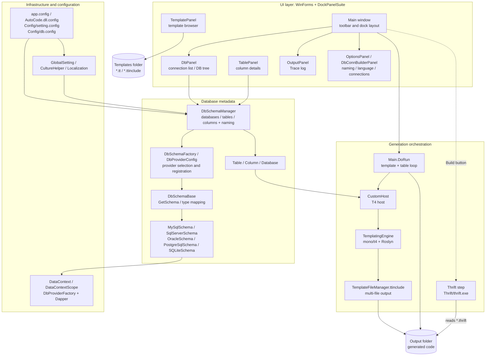
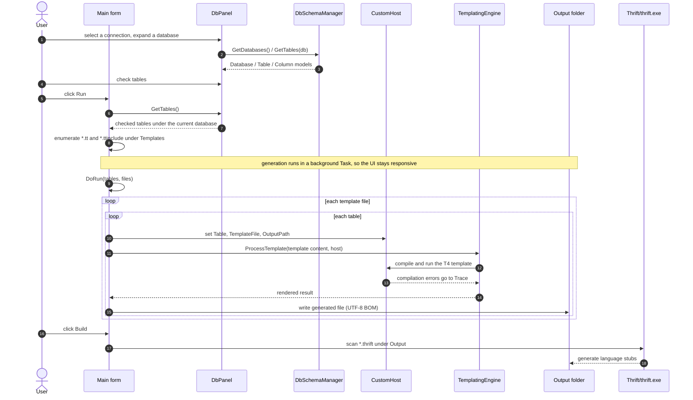

#  AutoCode

**English** | [简体中文](README.md)

[](LICENSE.md)


AutoCode (project name `Banana.AutoCode`, repository `CodeGenerator`) reads database schemas and batch-generates entities, CRUD, and front-end/back-end scaffolding via T4 templates; unzip, double-click `AutoCode.exe`, and you're ready to go.

**30-second path**

1. Run `AutoCode.exe`.
2. Open the connection window, choose a provider, and enter server (database file path for SQLite), port, database/instance, user, and password. Click **Test** to verify.
3. Save, then pick that connection in the left-hand drop-down, expand the database, and check the tables you want.
4. Click **Run** in the toolbar.
5. Take the generated files from `Output/<database>/`.

- **Five databases**: SQL Server, MySQL, Oracle, PostgreSQL, and SQLite.
- **Template coverage**: MyBatis, JPA, ASP.NET MVC, EasyUI, LayUI, Entity Framework, plus SqlSugar, FreeSql, and Thrift RPC templates.
- **Naming and mapping**: table prefixes/suffixes are stripped before PascalCase / camelCase conversion; each provider maps native types to template-ready type names.
- **Multi-file output**: `TemplateFileManager` lets one template emit several files and create subdirectories.
- **Platform and frameworks**: Windows desktop app; `net8.0-windows` is primary, with a legacy `.NET Framework 4.0` project.
- **Bilingual UI**: `en-US` / `zh-CN`, configurable in settings or the Options panel.

> **Boundary**: AutoCode is not an ORM and not a project scaffold. It only reads metadata and emits text files; you still copy the output into your solution and adapt it to project conventions.

<a id="why-autocode"></a>
## Why AutoCode?

AutoCode hands repetitive entities, CRUD, and front-end page scaffolding to templates so generated output stays consistent within a project. It does not try to replace an ORM or a project scaffold; its strengths are directly editable templates, explicit database coverage, and plain text output.


<details>
<summary>Positioning compared with common generators</summary>

| Tool | Form | Editable templates | Database coverage | Output | Multi-file | Cost |
| --- | --- | --- | --- | --- | --- | --- |
| AutoCode | Windows WinForms desktop tool | T4 templates, directly editable | SQL Server, MySQL, Oracle, PostgreSQL, SQLite | Text files under `Output` | Yes, via `TemplateFileManager` | Windows only; no CLI |
| CodeSmith Generator | Windows desktop tool | Its own templates, editable | Multiple databases (by edition and driver) | Code files | Yes | Commercial license; Windows only |
| T4 Toolbox | T4 helper/template library in Visual Studio | T4 templates | Depends on data-access code in the templates | Text files | Depends on the template | Requires Visual Studio and T4 |
| MyBatis-Plus Generator | Java ecosystem generator | Velocity / Freemarker and similar templates | Databases reachable over JDBC | Java / MyBatis-Plus source files | Yes | Tied to MyBatis-Plus and Java |
| Various web generators | Online, desktop, or CLI | Varies | Varies | Project scaffolding files | Usually | Often tied to a specific framework |

The table summarizes each tool's public positioning; unverified details are omitted. Refer to each project's documentation for specifics.

</details>

Read the [security notice](#security) before use: templates are executable code, can write files, and the sample connection strings contain plaintext credentials.

<a id="toc"></a>
## Table of Contents

- [Why AutoCode?](#why-autocode)
- [Quick Start](#quick-start)
- [Key Features](#features)
- [Architecture Overview](#architecture)
- [Key Configuration](#configuration)
- [Templates and Extension](#templates)
- [Known Limitations](#limitations)
- [FAQ](#faq)
- [Contributing](#contributing)
- [Getting Help](#support)
- [Acknowledgements](#acknowledgements)
- [License](#license)

<a id="quick-start"></a>
## Quick Start

<a id="security"></a>
> ⚠️ **Security notice (read before use)**
>
> - Templates are executable C# code compiled and run inside the AutoCode process. Only run trusted templates, and do not drop unknown `*.tt` / `*.ttinclude` files into `Templates`.
> - `TemplateFileManager` can create directories and write files under `OutputPath`. Confirm the output path and back up `Output` before generating.
> - `Config/db.config` ships with plaintext sample credentials, and connections saved in the UI are also written to it in plaintext. Replace the samples before use and never commit real credentials. A read-only metadata account is recommended.

### Requirements

| Scenario | Requirements |
| --- | --- |
| Run a release build | Windows; modern release packages are self-contained .NET 8 and need no separate runtime |
| Run the legacy net40 build | Windows XP / Server 2003 or later, .NET Framework 4.0+ |
| Build from source | Windows 10/11, .NET 8 SDK; Visual Studio 2022 is optional |
| Database account | Read access to database, table, and column metadata is sufficient |

### Option 1: Use a Release

1. Download the Windows package for your platform from [Releases](https://github.com/yuanrui/CodeGenerator/releases).
2. Unzip it, keep `Config`, `Templates`, and `Output` next to `AutoCode.exe`, then run the executable.
3. After launch, open the connection window in the UI, enter the connection details for your provider, and click **Test**, then save. The new connection appears in the left-hand list (do not use the repository's plaintext sample credentials).
4. Double-click to expand the database, check the tables, and click **Run**.
5. Take the generated files from `Output` and copy them into your solution.

### Option 2: Build from Source

```powershell
git clone https://github.com/yuanrui/CodeGenerator.git
cd CodeGenerator
dotnet build Banana.AutoCode.VS2022.sln -c Release
.\Banana.AutoCode\bin\Release\net8.0-windows\win-x64\AutoCode.exe
```

`Banana.AutoCode.VS2022.csproj` sets `SelfContained=true` and `RuntimeIdentifiers=win-x86;win-x64`, but does not set a single `RuntimeIdentifier`. `dotnet build` therefore chooses the output subdirectory from the host RID: on Windows x64 the verified output is `bin\Release\net8.0-windows\win-x64\AutoCode.exe`; on an x86 host it is `win-x86`. This is a build output, not a publish directory.

To produce a fixed-RID publish directory, run:

```powershell
dotnet publish Banana.AutoCode\Banana.AutoCode.VS2022.csproj -c Release -r win-x64
.\Banana.AutoCode\bin\Release\net8.0-windows\win-x64\publish\AutoCode.exe
```

Both build and publish copy `Config`, `Templates`, `AutoCode.dll.config`, and satellite resources. The `Thrift` directory is not part of the csproj copy items; if you need the Build feature, copy `Banana.AutoCode/Thrift` into the output directory manually. You can also open `Banana.AutoCode.VS2022.sln` in Visual Studio 2022 and press F5.

The net40 project (`Banana.AutoCode/Banana.AutoCode.csproj`) declares its dependencies only in `packages.config`; `packages/` is a local cache directory that is not committed (it is ignored by `.gitignore`). After cloning you must restore the packages into `packages/` before building, otherwise the assemblies referenced by `HintPath` in the csproj are missing and the build fails with unresolved references:

```powershell
nuget restore Banana.AutoCode\Banana.AutoCode.csproj
msbuild Banana.AutoCode\Banana.AutoCode.csproj /p:Configuration=Release /p:Platform=AnyCPU
```

`packages.config` is the single source of truth for net40 dependencies; upgrade or add packages there only. Building net40 also requires the .NET Framework 4.0 targeting pack on your machine. The `dotnet restore` / `dotnet build` commands above apply to the net8 project only; the two do not interfere.

### net40 vs. net8

| Item | net40 project | net8 project |
| --- | --- | --- |
| Project file | `Banana.AutoCode/Banana.AutoCode.csproj` | `Banana.AutoCode/Banana.AutoCode.VS2022.csproj` |
| Target framework | `.NET Framework 4.0` | `net8.0-windows` |
| T4 engine | `Core/Mono.TextTemplating` legacy engine plus a `Microsoft.VisualStudio.TextTemplating` copy | mono/t4 v2.3.1 fork under `_src`, compiled in-process with Roslyn |
| Compilation | Legacy engine default pipeline | `UseInProcessCompiler()`, templates compiled in-process |
| MySQL provider | `MySql.Data.MySqlClient` | `MySqlConnector` |
| Deployment | Requires the .NET Framework runtime | Self-contained; no separate runtime |
| Template syntax | T4 | Same as net40 |

Day-to-day development uses the `net8.0-windows` project; `net40` exists for older Windows environments, and both share the same template contract.

### Configure the Database

Connections are configured primarily in the UI: open the connection window from the main window, choose a provider, fill in server (database file path for SQLite), port, database/instance, user, and password, click **Test**, then save. The UI writes the connection to `Config/db.config` next to the executable and the left-hand connection drop-down updates immediately, so no manual file editing is needed.

`Config/db.config` is for **pre-seeding or migrating** a connection list: edit it directly only for bulk deployment, offline distribution, or when connection settings must be version-controlled. Credentials are stored in plaintext, so protect the file and do not commit real secrets. To pre-seed, add an entry by connection name:

```xml
<connectionStrings>
    <add name="mysql"
         connectionString="Data Source=localhost;Database=test;User Id=test;Password=123456;"
         providerName="MySqlConnector"/>
</connectionStrings>
```

Available `providerName` values:

| Database | .NET 8 project | .NET 4.0 project |
| --- | --- | --- |
| SQL Server | `System.Data.SqlClient` or `Microsoft.Data.SqlClient` | `System.Data.SqlClient` |
| MySQL | `MySqlConnector` | `MySql.Data.MySqlClient` |
| PostgreSQL | `Npgsql` | `Npgsql` |
| SQLite | `System.Data.SQLite` | `System.Data.SQLite` |
| Oracle | `Oracle.ManagedDataAccess.Client` | `Oracle.ManagedDataAccess.Client` |

Adding, editing, and deleting connections in the UI all write back to this file; restart the app after manual edits so pre-seeded entries are picked up.

### Generate Code

1. Select a connection name in the `DbPanel` drop-down.
2. Double-click a database node to expand its tables.
3. Check the tables you need (clicking a table node also loads its columns).
4. Click **Run** and watch the `OutputPanel` log.
5. Take the generated files from `Output/<database>/`.

The class library used by generated code is available at [yuanrui/Examples](https://github.com/yuanrui/Examples).

Switch the UI language in **Options**. It maps to `culture` in `Config/setting.config` (`zh-CN` or `en-US`; leave empty to follow the system, falling back to `en-US` when unsupported).

### Directory Overview

- `Config/`: `setting.config` holds naming rules and UI language; `db.config` holds connection strings written by the UI, and can also be pre-seeded or migrated.
- `Templates/`: built-in T4 templates grouped by stack.
- `Output/`: generated files, created automatically at startup.
- `Thrift/`: `thrift.exe`; source builds do not copy it automatically.

<details>
<summary>Expand the full directory tree</summary>

```text
CodeGenerator/
├─ Banana.AutoCode/                      # main WinForms application
│  ├─ Program.cs                         # entry point: environment, culture, main form
│  ├─ Forms/                             # main form and docked panels
│  │  ├─ Main.cs                         # toolbar, DoRun loop, Thrift invocation
│  │  ├─ DbPanel.cs                      # connection list, database/table tree, checks
│  │  ├─ TablePanel.cs                   # column details
│  │  ├─ TemplatePanel.cs                # template browser and preview
│  │  ├─ OutputPanel.cs                  # Trace log output
│  │  ├─ OptionsPanel.cs                 # naming prefixes/suffixes, UI language
│  │  ├─ DbConnBuilderPanel.cs           # connection editor, writes config back
│  │  └─ DbIconComboBox.cs               # owner-draw (icon + text) for both connection drop-downs
│  ├─ Core/                              # T4 host, data context, global settings
│  │  ├─ CustomHost.cs                   # T4 host exposing Table
│  │  ├─ DataContext.cs / DataContextScope.cs
│  │  ├─ GlobalSetting.cs                # removePrefix / removeSuffix
│  │  ├─ DbProviderIcons.cs              # provider → icon mapping and bitmap cache
│  │  └─ Mono.TextTemplating/            # T4 engine copy used by net40
│  ├─ _src/                              # mono/t4 v2.3.1 fork (net8)
│  │  ├─ Mono.TextTemplating/
│  │  └─ Mono.TextTemplating.Roslyn/
│  ├─ DbSchema/                          # metadata reading and type mapping
│  │  ├─ DbSchemaManager.cs              # unified databases/tables/columns + naming
│  │  ├─ DbSchemaBase.cs                 # GetSchema and type mapping abstraction
│  │  ├─ DbProviderConfig.cs             # provider registration and connection model
│  │  ├─ DbSchemaFactory.cs              # creates a schema by ProviderName
│  │  └─ Provider/                       # five database implementations
│  ├─ Templates/                         # built-in T4 templates by stack
│  ├─ Config/                            # setting.config / db.config
│  ├─ Thrift/                            # thrift.exe
│  ├─ Resources/                         # localization resources and icons
│  │  └─ DbIcons/                        # database type icons 16×16 / 32×32 + SOURCES.md
│  ├─ app.config / AutoCode.dll.config   # configuration forwarding
│  ├─ Banana.AutoCode.VS2022.csproj      # net8.0-windows project
│  └─ Banana.AutoCode.csproj             # net40 project (VS2019)
├─ Banana.AutoCode.VS2022.sln            # main solution (.NET 8)
├─ Banana.AutoCode.VS2019.sln            # legacy solution (.NET 4.0)
├─ Directory.Build.props                 # version and shared properties
├─ LICENSE.md                            # MIT
└─ README.md / README-EN.md
```

</details>

<a id="features"></a>
## Key Features

- **Five database engines**: MySQL, PostgreSQL, SQLite, SQL Server, and Oracle.
- **Template-driven**: built-in T4 templates for MyBatis, JPA, Entity Framework, SqlSugar, FreeSql, EasyUI, LayUI, Thrift RPC, TypeScript entities, and more.
- **Visual workflow**: connection management, database/table tree, column details, template browser, and run log in one docked window.
- **Name normalization**: strips configured table prefixes/suffixes and converts names to PascalCase / CamelCase, producing class names such as `UserEntity`.
- **Type mapping**: each database provider maps native column types to .NET types, `DbType`, and type names.
- **Multi-file output**: templates can use `TemplateFileManager.ttinclude` to emit several files into subdirectories under `Output`.
- **Thrift stubs**: generated `*.thrift` files can be compiled with the repository's `Thrift/thrift.exe` into multiple languages.
- **Bilingual UI**: built-in `zh-CN` / `en-US` resources, switchable in Options.
- **Two target frameworks**: the modern project targets `net8.0-windows`; a legacy project keeps the `.NET Framework 4.0` build chain.

<a id="architecture"></a>
## Architecture Overview

AutoCode is organized in four layers: UI, generation orchestration, database metadata, and infrastructure. The UI only selects connections, tables, and templates. The actual generation logic lives in `Main.DoRun`, which hands a `Table` model to the T4 engine through `CustomHost`.

If the diagram is not obvious, read these six steps first:

1. **Startup**: `Program.Main` calls `SetEnvironment`, sets the current directory to the executable folder, writes `APP_DIR`, `OUTPUT_DIR`, and `TEMPLATES_DIR`, enables Oracle `BindByName`, lets `CultureHelper` choose the UI language, and finally calls `Application.Run(new Main())`.
2. **Connection and metadata**: `DbPanel` reads connection names from `ConfigurationManager.ConnectionStrings`; selecting a connection calls `GetDatabases()` asynchronously, double-clicking a database calls `GetTables(db)`, and clicking a table calls `GetColumns(table)` in `TablePanel`.
3. **Table selection**: `DbPanel.GetTables()` returns only checked tables under the **currently selected database node**. Nothing is generated without a database and checked tables.
4. **Rendering**: `Main.DoRun` enumerates `*.tt` and `*.ttinclude` under `Templates`, sets host state for each template/table pair, and calls `ProcessTemplate`. Blank results are skipped; `FILE_NAME` overrides the default `DisplayName`.
5. **Writing**: output defaults to `Output/<database>/<DisplayName><extension>`; templates using `TemplateFileManager` can write to custom subdirectories under `OutputPath`. Files are written as UTF-8 with BOM.
6. **Thrift**: the toolbar Build button scans `*.thrift` under `Output` and invokes `Thrift/thrift.exe` for the fixed language set `java`, `csharp`, `js`, `js:ts`, `js:node`, `py`, and `cpp`.

The complete layered structure behind those six steps:



The four layers and their nodes:

- **UI layer (WinForms + DockPanelSuite)**: `Main` owns the toolbar and dock layout, `DbPanel` manages the connection drop-down and database tree, `TablePanel` shows column details, `TemplatePanel` browses and previews templates, `OutputPanel` shows the Trace log, and `OptionsPanel` / `DbConnBuilderPanel` handle naming rules, language, and connection editing.
- **Generation orchestration**: `Main.DoRun` drives the template × table loop, `CustomHost` is the T4 host exposing `Table` to templates, `TemplatingEngine` runs mono/t4 + Roslyn, `TemplateFileManager.ttinclude` handles multi-file output; templates are read from `Templates` and artifacts are written to `Output`, and the Build button runs the Thrift step.
- **Database metadata**: `DbSchemaManager` reads databases/tables/columns and applies naming conversion, `DbSchemaFactory` / `DbProviderConfig` select and register providers, `DbSchemaBase` abstracts `GetSchema` and type mapping, the five providers implement each database, and `Table` / `Column` / `Database` are the models.
- **Infrastructure and configuration**: `DataContext` / `DataContextScope` provide `DbProviderFactory` + Dapper, `app.config` / `AutoCode.dll.config` and the `Config` directory supply configuration, and `GlobalSetting` / `CultureHelper` / `Localization` supply naming rules, language, and localization.

Naming and output rules:

- `DisplayName = PascalCase(FixPrefixAndSuffix(table name))`; all-uppercase names are lowercased first; prefixes are matched longest-first so `T_` does not preempt `T_SYS`.
- Prefixes/suffixes come from `removePrefix` / `removeSuffix` in `Config/setting.config`; see [Known Limitations](#limitations) for the current `removeSuffix` behavior.
- The output directory uses the database name (`Table.Owner`), so same-named tables in different databases do not overwrite each other.

<details>
<summary>Runtime sequence diagram</summary>



</details>

<a id="configuration"></a>
## Key Configuration

| Setting | Location | Purpose | Default / example |
| --- | --- | --- | --- |
| `removePrefix` | `Config/setting.config` → `appSettings` | Table prefixes removed before class-name generation; comma or semicolon separated, longest first | `T_SYS,T_MAN,T_BUS,T_BAS_,T_BIZ_,T_MON,T_` |
| `removeSuffix` | Same | Table suffixes removed before class-name generation; see [Known Limitations](#limitations) for current behavior | Empty |
| `culture` | Same | UI language | Empty (follow system); `zh-CN` / `en-US` |
| `connectionStrings` | `Config/db.config` | Connection name, string, and provider; written by the UI, and can also be pre-seeded or migrated | `mssql`, `sqlite`, `oracle`, `mysql` samples |
| `configSource` | `app.config` / `AutoCode.dll.config` | Forwards `appSettings` and `connectionStrings` into `Config` | `Config\setting.config`, `Config\db.config` |
| `APP_DIR` / `OUTPUT_DIR` / `TEMPLATES_DIR` | `Program.SetEnvironment` | Runtime environment variables used by templates and internal logic | executable folder, `exe\Output`, `exe\Templates` |
| `TEMPLATES_DIR` / `OUTPUT_DIR` | `Core/ConfigConstants.cs` | Fixed directory names | `Templates`, `Output` |

The configuration forwarding chain has no additional precedence layers:

```text
ConfigurationManager.AppSettings["removePrefix"]
└─ app.config / AutoCode.dll.config
   └─ <appSettings configSource="Config\setting.config" />
      └─ Config/setting.config

ConfigurationManager.ConnectionStrings["mysql"]
└─ app.config / AutoCode.dll.config
   └─ <connectionStrings configSource="Config\db.config" />
      └─ Config/db.config
```

Saving in the UI writes directly back to the configuration files next to the executable.

<a id="templates"></a>
## Templates and Extension

### Template Host Contract

For every `(template, table)` pair, `CustomHost` exposes the following to the template:

- `host.Table`: the `Table` object for the current table.
- `host.GetValue("OutputPath")`: the output directory for the current table, by default `Output/<database>`.
- `host.SetValue("FILE_NAME", "name")`: optional output file name without extension; when unset, `Table.DisplayName` is used.
- `<#@ output extension=".cs" #>`: output extension; the host default is `.cs`.
- `TemplateFileManager.ttinclude`: multi-file helper with `Manager.Create(host, GenerationEnvironment)`, `StartNewFile(name, folder)`, `EndBlock()`, and `Process(true)`.

Templates live under `Templates`, end with `*.tt` or `*.ttinclude`, and follow [T4 template syntax](https://docs.microsoft.com/en-us/visualstudio/modeling/code-generation-and-t4-text-templates). Each `*.tt` template runs once for every selected table.

A minimal entity template of about 30 lines:

```csharp
<#@ template language="C#" hostSpecific="true" debug="false" #>
<#@ output encoding="utf-8" extension=".cs" #>
<#@ include file="../TemplateFileManager.ttinclude" #>
<#
    CustomHost host = (CustomHost)(Host);
    Table table = host.Table;
    var manager = Manager.Create(host, GenerationEnvironment);
    manager.StartNewFile(table.DisplayName + "Entity.generated.cs",
        host.GetValue("OutputPath").ToString() + "\\Generated");
#>
// <auto-generated />
namespace Banana.Data
{
    public partial class <#= table.DisplayName #>Entity
    {
<#
        foreach (var column in table.Columns)
        {
#>
        /// <summary>
        /// <#= column.Comment #>
        /// </summary>
        public virtual <#= column.TypeName #> <#= column.Name #> { get; set; }

<#
        }
#>
    }
}
<#
    manager.EndBlock();
    manager.Process(true);
#>
```

<details>
<summary>Expand the full example (with Clone methods)</summary>

```csharp
<#@ template language="C#" hostSpecific="true" debug="false" #>
<#@ output encoding="utf-8" extension=".cs" #>
<#@ include file="../TemplateFileManager.ttinclude" #>
<#
    CustomHost host = (CustomHost)(Host);
    Table table = host.Table;
    var manager = Manager.Create(host, GenerationEnvironment);
    manager.StartNewFile(table.DisplayName + "Entity.generated.cs",
        host.GetValue("OutputPath").ToString() + "\\Samples\\Generated");
#>
//------------------------------------------------------------------------------
// <copyright file="<#= table.DisplayName #>Entity.cs">
//    Copyright (c) <#= DateTime.Now.ToString("yyyy") #>, All rights reserved.
// </copyright>
// <author><#= Environment.UserName #></author>
// <date><#= DateTime.Now.ToString("yyyy-MM-dd HH:mm:ss") #></date>
//------------------------------------------------------------------------------

using System;
using System.Collections.Generic;
using System.Text;

namespace Banana.Data
{
    /// <summary>
    /// <#= string.IsNullOrEmpty(table.Comment) ? string.Format("Table/View [{0}] map to [{1}] entity class", table.Name, table.DisplayName) : table.Comment #>
    /// </summary>
    public partial class <#= table.DisplayName #>Entity : ICloneable
    {
<#
        foreach (var column in table.Columns)
        {
#>
        /// <summary>
        /// get or set <#= column.Comment #>
        /// </summary>
        public virtual <#= column.TypeName #> <#= column.Name #> { get; set; }

<#
        }
#>
        public virtual <#= table.DisplayName #>Entity CloneFrom(<#= table.DisplayName #>Entity thatObj)
        {
            if (thatObj == null)
            {
                throw new ArgumentNullException("thatObj");
            }

<#
        foreach (var column in table.Columns)
        {
#>
            this.<#= column.Name #> = thatObj.<#= column.Name #>;
<#
        }
#>

            return this;
        }

        public virtual <#= table.DisplayName #>Entity CloneTo(<#= table.DisplayName #>Entity thatObj)
        {
            if (thatObj == null)
            {
                throw new ArgumentNullException("thatObj");
            }

<#
        foreach (var column in table.Columns)
        {
#>
            thatObj.<#= column.Name #> = this.<#= column.Name #>;
<#
        }
#>

            return thatObj;
        }

        public virtual <#= table.DisplayName #>Entity Clone()
        {
            var thatObj = new <#= table.DisplayName #>Entity();

            return this.CloneTo(thatObj);
        }

        object ICloneable.Clone()
        {
            return this.Clone();
        }
    }
}
<#
    manager.EndBlock();
    manager.Process(true);
#>
```

</details>

The `host.Table` object is a `Table` with these properties:

| # | Name | Type | Description |
| :--- | :--- | :--- | :--- |
| 1 | `Id` | `String` | Identifier |
| 2 | `Name` | `String` | Table name |
| 3 | `Comment` | `String` | Table comment |
| 4 | `DisplayName` | `String` | Display name after naming rules |
| 5 | `Owner` | `String` | Database name |
| 6 | `PrimaryKeyIsNumber` | `Boolean` | Whether the primary key is numeric |
| 7 | `Columns` | `IList<Column>` | Collection of columns |
| 8 | `PrimaryKeyColumns` | `IList<Column>` | Primary-key columns |
| 9 | `NonPrimaryKeyColumns` | `IList<Column>` | Non-primary-key columns |

The `Column` type has these properties:

| # | Name | Type | Description |
| :--- | :--- | :--- | :--- |
| 1 | `Id` | `String` | Identifier |
| 2 | `Name` | `String` | Column name |
| 3 | `RawType` | `String` | Native column type |
| 4 | `DataType` | `DbType` | .NET `DbType` |
| 5 | `Type` | `Type` | .NET `Type` |
| 6 | `TypeName` | `String` | Column type name |
| 7 | `Comment` | `String` | Column comment |
| 8 | `IsPrimaryKey` | `Boolean` | Whether it is a primary key |
| 9 | `IsForeignKey` | `Boolean` | Whether it is a foreign key |
| 10 | `IsUnique` | `Boolean` | Whether it is unique |
| 11 | `IsNullable` | `Boolean` | Whether it is nullable |
| 12 | `Length` | `Int64` | Length |
| 13 | `Precision` | `Int16` | Precision |
| 14 | `Scale` | `Int16` | Scale |
| 15 | `Index` | `Int32` | Column index |
| 16 | `Table` | `Table` | Owning `Table` object |

> Security reminder: templates are executable C# code, and `TemplateFileManager` can create directories and write files; see the [security notice](#security).

### Add a Template

1. Create a `.tt` file under `Templates/<stack>/` with a PascalCase name (for example `Entity.tt` or `Controller.tt`).
2. Follow the minimal example: declare the `template` and `output` directives and include `TemplateFileManager.ttinclude`.
3. Run generation again; the new template is discovered automatically without code changes.

Existing groups under `Templates` include `EasyUI`, `EntityFramework`, `Java/JPA`, `Java/MyBatis`, `JavaScript`, `Layui`, `MySQL`, `Oracle`, `SqlSugar`, `FreeSql`, `Samples`, `Thrift`, and `Test`.

Before submitting a template, check:

- Do not use `DateTime.Now`, `Environment.UserName`, or similar runtime values; the same input should produce the same output.
- Set `FILE_NAME` and the output extension explicitly instead of relying on host state left by a previous template.
- Blank output is skipped; do not put required side effects behind a template that may render empty.
- `*.ttinclude` is also enumerated and executed as a template; keep it as pure definitions/helpers and avoid large output.
- Multi-file output should go through `TemplateFileManager`, with paths under `OutputPath`.
- After generating, check `Output` and `OutputPanel`, and make sure no real connection strings or credentials end up in templates or samples.

### Add a Database Provider

1. Create `XxxSchema : DbSchemaBase` under `DbSchema/Provider/` and implement `GetDatabases`, `GetTables`, `GetColumns`, `GetType`, and `GetDbType`.
2. Register the `DbSchemaBase` and `DbViewModel` by `ProviderName` (invariant name) in `DbProviderConfig._providerFactory`.
3. In the `#if NET` branch of the `Program` static constructor, call `DbProviderFactories.RegisterFactory(...)` (.NET 8).
4. For the legacy .NET 4.0 build, add the entry under `<system.data><DbProviderFactories>` in `app.config`.
5. Add a connection in the UI (or pre-seed `Config/db.config`) and verify database/table/column reading and type mapping.

For a Provider PR, include: the target database type and version, the `providerName` (invariant name), a redacted connection string sample, type-mapping evidence (native type → `DbType` / .NET `Type` / `TypeName`), and any net40 vs. net8 differences.

<a id="limitations"></a>
## Known Limitations

| Limitation | Impact | Mitigation |
| --- | --- | --- |
| GUI only; no CLI, exit codes, or structured diagnostics | Cannot be scripted or used in CI | Run from the desktop UI; batch use requires custom wrapping or future capabilities |
| Template discovery executes `*.ttinclude` as templates too | Extra render cost; helper files with output are written | Keep `*.ttinclude` as pure definitions/helpers; blank results are skipped |
| `TemplatingEngine` and `CustomHost` are reused across the whole run | `FileExtension`, `FILE_NAME`, and other host state can leak between templates | Set file name and extension explicitly in each template |
| Built-in templates use `DateTime.Now` and `Environment.UserName` | Byte-level output differs between runs, which hurts diffs | Fix time/author before generation, or compare structure rather than bytes |
| Errors only go to `Trace`; an unregistered `providerName` silently falls back to SQL Server metadata | Failures can appear as zero tables or wrong type mappings instead of a clear error | Check `OutputPanel`; verify the `providerName` is registered in `DbProviderConfig` |
| The Thrift child process is not awaited, its stdout is not redirected, and its exit code is not checked; source builds do not copy `Thrift` | Build may return early or produce no stubs | Copy `Thrift` manually, inspect `Output`, or run `thrift.exe` directly |
| `Config/db.config` stores connection credentials in plaintext and ships with sample credentials | Using it directly can leak credentials or connect to the wrong database | Configure through the UI and replace the samples; never commit real credentials; use a read-only metadata account |
| `removeSuffix` currently removes the first N characters of a name, not the trailing N characters | Configured suffixes can produce unexpected class names | Prefer `removePrefix`; rename the table if a suffix must be removed, pending a fix |

<a id="faq"></a>
## FAQ

<details>
<summary>Why are zero files generated even though I checked tables?</summary>

- Generation only targets checked tables under the **currently selected database node**; select the database first, then check tables.
- Templates whose render result is blank are skipped; helper files such as `*.ttinclude` produce no content and are skipped too.
- When a database connection fails, `DbSchemaManager` catches the exception and returns an empty set, so the UI may show zero tables. Check the `OutputPanel` log, connection string, `providerName`, and account permissions.

</details>

<details>
<summary>Why is the column list empty or why are columns missing from the output?</summary>

Column metadata is loaded when `TablePanel` opens; the generation pass does not reload columns. Click the table node first and confirm the column panel is populated before generating.

</details>

<details>
<summary>Which databases are supported?</summary>

MySQL, PostgreSQL, SQLite, SQL Server, and Oracle. The `providerName` in the connection string must match the table above.

</details>

<details>
<summary>Can it run on Linux/macOS?</summary>

No. The application is built on WinForms with the `net8.0-windows` target.

</details>

<details>
<summary>Is there a CLI or LLM integration?</summary>

Not currently. AutoCode is GUI-only today: there is no CLI, MCP server, or LLM integration, and all generation happens in the desktop app.

</details>

<details>
<summary>Will generation overwrite existing files?</summary>

Yes. `Main.DoRun` calls `File.WriteAllText` unconditionally and does not detect manual edits. Keep generated output separate from hand-written code, or commit/back up first.

</details>

<details>
<summary>Thrift Build does nothing or fails?</summary>

The Build button scans `*.thrift` under `Output` and invokes `Thrift/thrift.exe`. The current implementation does not wait for the child process or check its exit code. Check the `OutputPanel` log and confirm that `Thrift/thrift.exe` exists next to the executable (source builds do not copy that directory automatically).

</details>

<details>
<summary>The generated class name is unexpected; what should I check?</summary>

Check `removePrefix` in `Config/setting.config`: prefixes are matched longest-first, not in the order written. All-uppercase table names are lowercased before PascalCase conversion. `removeSuffix` currently removes the first N characters of the name instead of the trailing N; prefer `removePrefix` or rename the table when naming is wrong. Restarting the app after changing configuration is the safest option.

</details>

<details>
<summary>How do I debug a template?</summary>

Use `<# Write("table=" + table.Name) #>` to put intermediate values into the generated file and inspect the result, or `Trace.WriteLine(...)` to write to `OutputPanel` (registered by `Main.Init` through `OutputTraceListener`). For complex templates, reduce the run to one table and one template first.

</details>

<details>
<summary>Can generation write to a custom directory?</summary>

By default, output goes to `Output/<database>/`, and the root is fixed next to the executable. A template can read `host.GetValue("OutputPath")` and call `TemplateFileManager.StartNewFile(name, folder)` to choose a subdirectory under `OutputPath`; `FILE_NAME` controls the file name without extension. The UI currently has no setting for changing the output root.

</details>

<details>
<summary>What should I watch out for when migrating from net40 to net8?</summary>

Switch to `Banana.AutoCode.VS2022.csproj` and `net8.0-windows`; the T4 engine moves from `Core/Mono.TextTemplating` to the `_src` mono/t4 fork with `UseInProcessCompiler()`; MySQL changes from `MySql.Data.MySqlClient` to `MySqlConnector`; release builds become self-contained. Template syntax and the `CustomHost` contract stay the same, so focus regression testing on provider type mapping and the Thrift copy step.

</details>

<details>
<summary>Why can't I type into the two connection drop-downs?</summary>

Both drop-downs use the `DropDownList` style, so values can only be picked from the list. A `Provider` must match a name registered in `DbProviderConfig`, and a connection name must already exist in `ConnectionStrings`; typed text can neither be saved nor used to read metadata.

</details>

<a id="contributing"></a>
## Contributing

Issues and pull requests are welcome for bug reports, new templates, and provider improvements.

**Adding a template**

1. Place it under `Banana.AutoCode/Templates/<stack>/` with a PascalCase name (for example `Entity.tt` or `Controller.tt`).
2. Use `*.tt` as the entry point and keep `*.ttinclude` for shared definitions; do not put required side effects in a template that may render empty.
3. Use `TemplateFileManager` for multi-file output and keep every path under `OutputPath`.
4. Before submitting, walk through the template self-check list above and run one local generation to confirm `Output` and `OutputPanel` behave.

**Provider PRs**

New database providers are welcome. Please include:

- Target database type and version.
- `ProviderName` (invariant name) and how it is registered in `DbProviderConfig`.
- A redacted connection string sample.
- Type-mapping evidence: native type → `DbType` / .NET `Type` / `TypeName`.
- net40 vs. net8 differences if both projects are supported.

**UI strings**

UI strings live in `Resources/Localization.resx` (neutral English) and `Localization.zh-CN.resx`; both files must keep the same key set.

1. Add the same key to both resx files with the text for each language.
2. Confirm `Localization.Designer.cs` exposes a matching property (add the `public static string` member manually if it is not generated).
3. Reference it as `Localization.xxx` in code instead of hard-coding UI text.

Make sure the change contains no real connection strings, credentials, personal paths, or generated temporary files. See the [TODO List](https://github.com/yuanrui/CodeGenerator/issues/1) for open items.

<a id="support"></a>
## Getting Help

- Questions and bugs: [Issues](https://github.com/yuanrui/CodeGenerator/issues)
- Open items and roadmap: [TODO List](https://github.com/yuanrui/CodeGenerator/issues/1)
- Release history: [Releases](https://github.com/yuanrui/CodeGenerator/releases)

When asking for help, include your Windows version, whether you use net8 or net40, the database type, `providerName`, reproduction steps, and the `OutputPanel` log. Redact connection strings. The repository has no `CHANGELOG` file; use the Releases page for version changes, and note that the version number is controlled by `<Version>` in `Directory.Build.props`.

If this project helps you, a Star is the most direct support: [github.com/yuanrui/CodeGenerator](https://github.com/yuanrui/CodeGenerator).

<a id="acknowledgements"></a>
## Acknowledgements

| Dependency | Purpose | License |
| --- | --- | --- |
| [mono/t4](https://github.com/mono/t4) | T4 template engine (net8 uses the v2.3.1 fork under `_src`) | MIT |
| Dapper | Metadata queries and data access | Apache-2.0 |
| DockPanelSuite | WinForms docking layout | MIT |
| Roslyn (`Microsoft.CodeAnalysis`) | In-process T4 compilation on net8 | MIT |
| [DBeaver](https://github.com/dbeaver/dbeaver) | Database type icons (16×16 / 32×32; see [SOURCES.md](Banana.AutoCode/Resources/DbIcons/SOURCES.md) for origins and licenses) | Apache-2.0 |

License information comes from each package's `nuspec` or source headers; refer to each project for details.

<a id="license"></a>
## License

This project is licensed under the [MIT License](LICENSE.md).
