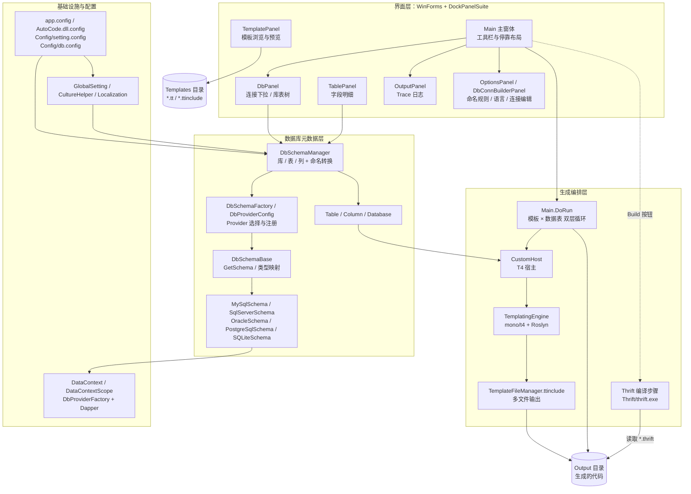
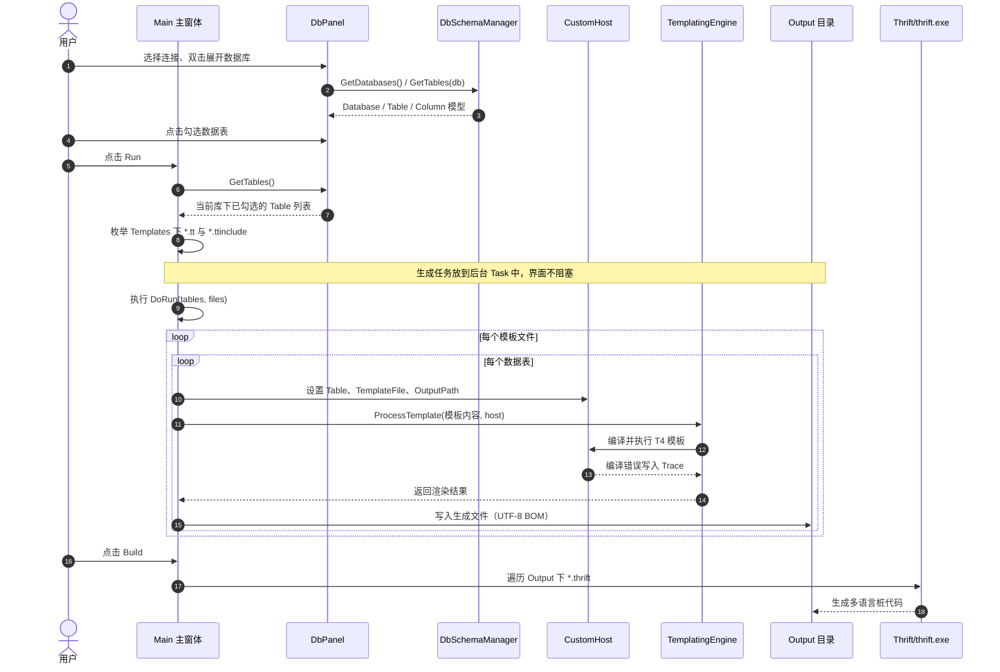

#  AutoCode

[English](README-EN.md) | **简体中文**

[](LICENSE.md)


AutoCode（工程名 `Banana.AutoCode`，仓库 `CodeGenerator`）读取数据库表结构，用 T4 模板批量生成实体类、CRUD 与前后端脚手架；下载解压、双击 `AutoCode.exe` 即可使用。

**30 秒上手**

1. 运行 `AutoCode.exe`。
2. 打开连接窗口，选择 Provider，填写服务器（SQLite 填数据库文件路径）、端口、数据库/实例、账号与密码，点 **测试** 验证连接。
3. 保存后，在左侧连接下拉中选择该连接，双击展开数据库并勾选要生成的表。
4. 点击工具栏 **Run**。
5. 到 `Output/<数据库名>/` 取走生成文件。

- **五种数据库**：SQL Server、MySQL、Oracle、PostgreSQL、SQLite。
- **模板覆盖**：MyBatis、JPA、ASP.NET MVC、EasyUI、LayUI、Entity Framework，另有 SqlSugar、FreeSql、Thrift RPC 模板。
- **命名与映射**：表名去前后缀后转 PascalCase / camelCase，各 Provider 把数据库类型映射为模板可用的类型名。
- **多文件输出**：`TemplateFileManager` 支持一个模板拆分多个文件，并自动创建子目录。
- **平台与框架**：Windows 桌面应用；`net8.0-windows` 为主，保留 `.NET Framework 4.0` 旧工程。
- **双语界面**：`en-US` / `zh-CN`，可在配置或选项里指定。

> **边界**：AutoCode 不是 ORM，也不是项目脚手架；它只读取元数据并生成文本文件，生成结果仍需复制到目标解决方案并按项目规范调整。

<a id="why-autocode"></a>
## 为什么是 AutoCode？

AutoCode 把重复的实体、CRUD 和前端页面脚手架交给模板，让同一项目里的生成结果保持一致。它不试图替代 ORM 或项目脚手架，优势在于模板可直接编辑、数据库覆盖明确、输出就是普通文本文件。


<details>
<summary>与常见生成工具的定位对比</summary>

| 工具 | 形态 | 模板可编辑性 | 数据库覆盖 | 输出方式 | 多文件支持 | 代价 |
| --- | --- | --- | --- | --- | --- | --- |
| AutoCode | Windows WinForms 桌面工具 | T4 模板，可直接编辑 | SQL Server、MySQL、Oracle、PostgreSQL、SQLite | 文本文件写入 `Output` | 支持，`TemplateFileManager` | 仅 Windows；无 CLI |
| CodeSmith Generator | Windows 桌面工具 | 自有模板，可编辑 | 多种数据库（按版本与驱动） | 代码文件 | 支持 | 商业授权；仅 Windows |
| T4 Toolbox | Visual Studio 中的 T4 辅助工具/模板库 | T4 模板 | 取决于模板中的数据访问代码 | 文本文件 | 取决于模板 | 依赖 Visual Studio 与 T4 |
| MyBatis-Plus Generator | Java 生态生成器 | Velocity / Freemarker 等模板 | JDBC 可连接的数据库 | Java / MyBatis-Plus 源文件 | 支持 | 绑定 MyBatis-Plus 与 Java 技术栈 |
| 各类 Web 生成器 | 在线、桌面或 CLI 均有 | 随实现而定 | 随实现而定 | 项目脚手架文件 | 通常支持 | 常绑定特定框架 |

表中信息按各工具的公开定位概括；未核实项不展开，具体以其官方文档为准。

</details>

使用前请先读[安全提示](#security)：模板是可执行代码、可写文件，示例连接串含明文密码。

<a id="toc"></a>
## 目录

- [为什么是 AutoCode](#why-autocode)
- [快速开始](#quick-start)
- [核心特性](#features)
- [架构总览](#architecture)
- [关键配置项](#configuration)
- [模板与二次开发](#templates)
- [已知限制](#limitations)
- [FAQ](#faq)
- [参与贡献](#contributing)
- [获取帮助](#support)
- [致谢](#acknowledgements)
- [License](#license)

<a id="quick-start"></a>
## 快速开始

<a id="security"></a>
> ⚠️ **安全提示（使用前必读）**
>
> - 模板是可执行的 C# 代码，会在 AutoCode 进程内编译运行；只运行可信模板，不要把来源不明的 `*.tt` / `*.ttinclude` 放进 `Templates`。
> - `TemplateFileManager` 可以在 `OutputPath` 下创建目录并写文件；生成前确认输出路径并备份 `Output`。
> - `Config/db.config` 自带明文示例账号密码，界面保存的连接也以明文写入该文件；使用前替换示例凭据，不要提交真实凭据。建议使用只读元数据权限的账号。

### 环境要求

| 场景 | 要求 |
| --- | --- |
| 直接运行发行版 | Windows；现代发行包基于自包含的 .NET 8，无需单独安装运行时 |
| 使用旧版 net40 构建 | Windows XP / Server 2003 及以上，.NET Framework 4.0+ |
| 从源码构建 | Windows 10/11，.NET 8 SDK；也可使用 Visual Studio 2022 |
| 数据库账号 | 只需读取库、表、列（column）等元数据的权限 |

### 方式一：使用发行版

1. 从 [Releases](https://github.com/yuanrui/CodeGenerator/releases) 下载对应 Windows 版本的压缩包。
2. 解压后保持 `Config`、`Templates`、`Output` 与 `AutoCode.exe` 同级，再运行 `AutoCode.exe`。
3. 运行后在界面里打开连接窗口，按 Provider 填写连接信息并点 **测试**；保存后即可在左侧选择该连接（不要直接使用仓库自带的明文示例凭据）。
4. 双击展开数据库、勾选数据表，点击 **Run**。
5. 到 `Output` 目录取走生成代码，复制到目标解决方案。

### 方式二：从源码构建

```powershell
git clone https://github.com/yuanrui/CodeGenerator.git
cd CodeGenerator
dotnet build Banana.AutoCode.VS2022.sln -c Release
.\Banana.AutoCode\bin\Release\net8.0-windows\win-x64\AutoCode.exe
```

`Banana.AutoCode.VS2022.csproj` 设置了 `SelfContained=true` 与 `RuntimeIdentifiers=win-x86;win-x64`，但没有固定单一 `RuntimeIdentifier`。`dotnet build` 会按当前主机的 RID 选择输出子目录：Windows x64 上实测产物是 `bin\Release\net8.0-windows\win-x64\AutoCode.exe`；在 x86 主机上对应 `win-x86`。这是 build 输出，不是 publish 目录。

需要固定 RID 的发布目录时，额外执行：

```powershell
dotnet publish Banana.AutoCode\Banana.AutoCode.VS2022.csproj -c Release -r win-x64
.\Banana.AutoCode\bin\Release\net8.0-windows\win-x64\publish\AutoCode.exe
```

build 与 publish 都会复制 `Config`、`Templates`、`AutoCode.dll.config` 和本地化资源；`Thrift` 目录不在 csproj 的复制项里，如需使用 Build 功能，请手动把 `Banana.AutoCode/Thrift` 复制到输出目录。也可以直接用 Visual Studio 2022 打开 `Banana.AutoCode.VS2022.sln` 后按 F5 调试。

net40 工程（`Banana.AutoCode/Banana.AutoCode.csproj`）的依赖只由 `packages.config` 声明，`packages/` 是本地缓存目录、不纳入版本库（已被 `.gitignore` 忽略）。克隆后必须先把包还原到 `packages/` 再编译，否则 csproj 中 `HintPath` 指向的程序集不存在，会报找不到引用：

```powershell
nuget restore Banana.AutoCode\Banana.AutoCode.csproj
msbuild Banana.AutoCode\Banana.AutoCode.csproj /p:Configuration=Release /p:Platform=AnyCPU
```

`packages.config` 是 net40 依赖的唯一声明来源，升级或增删依赖时只需改它；net40 编译还需要本机安装 .NET Framework 4.0 目标包。上面的 `dotnet restore` / `dotnet build` 只针对 net8 工程，两者互不影响。

### net40 与 net8 的差异

| 项目 | net40 工程 | net8 工程 |
| --- | --- | --- |
| 工程文件 | `Banana.AutoCode/Banana.AutoCode.csproj` | `Banana.AutoCode/Banana.AutoCode.VS2022.csproj` |
| 目标框架 | `.NET Framework 4.0` | `net8.0-windows` |
| T4 引擎 | `Core/Mono.TextTemplating` 旧引擎 + `Microsoft.VisualStudio.TextTemplating` 副本 | `_src` 中的 mono/t4 v2.3.1 fork，配合 Roslyn 进程内编译 |
| 编译方式 | 旧引擎默认编译流程 | `UseInProcessCompiler()`，模板在进程内编译 |
| MySQL Provider | `MySql.Data.MySqlClient` | `MySqlConnector` |
| 部署 | 依赖 .NET Framework 运行时 | 自包含发布，无需单独安装运行时 |
| 模板语法 | T4 | 与 net40 一致 |

日常开发以 `net8.0-windows` 工程为准；`net40` 用于兼容旧 Windows 环境，模板契约保持一致。

### 配置数据库

连接配置以界面为主：在主窗口打开连接窗口，选择 Provider，填写服务器（SQLite 为数据库文件路径）、端口、数据库/实例、账号与密码，点 **测试** 验证，再保存。保存后连接信息由界面写入 exe 同级的 `Config/db.config`，左侧连接下拉立即可用，无需手工改文件。

`Config/db.config` 用于**预置或迁移**连接清单：批量部署、离线分发或需要把连接配置纳入版本管理时，才建议直接编辑该文件。文件以明文保存账号密码，注意文件权限与提交范围。预置时按连接名添加一条记录：

```xml
<connectionStrings>
    <add name="mysql"
         connectionString="Data Source=localhost;Database=test;User Id=test;Password=123456;"
         providerName="MySqlConnector"/>
</connectionStrings>
```

`providerName` 的可用值：

| 数据库 | .NET 8 工程 | .NET 4.0 工程 |
| --- | --- | --- |
| SQL Server | `System.Data.SqlClient` 或 `Microsoft.Data.SqlClient` | `System.Data.SqlClient` |
| MySQL | `MySqlConnector` | `MySql.Data.MySqlClient` |
| PostgreSQL | `Npgsql` | `Npgsql` |
| SQLite | `System.Data.SQLite` | `System.Data.SQLite` |
| Oracle | `Oracle.ManagedDataAccess.Client` | `Oracle.ManagedDataAccess.Client` |

界面中的新增、修改与删除连接都会写回这个文件；手工编辑后重启应用，确保读到预置项。

### 生成代码

1. 在 `DbPanel` 顶部下拉框选择连接名。
2. 双击数据库节点展开表列表。
3. 点击表节点前的复选框勾选需要生成的表（点击表节点会同时加载列信息）。
4. 点击工具栏 **Run**，在 `OutputPanel` 查看日志。
5. 到 `Output/<数据库名>/` 取走生成文件。

生成代码所依赖的类库见：[yuanrui/Examples](https://github.com/yuanrui/Examples)。

界面语言可在 **Options** 中切换中文/English，对应 `Config/setting.config` 的 `culture`（`zh-CN` 或 `en-US`；留空则跟随系统，不支持时回退 `en-US`）。

### 目录速览

- `Config/`：`setting.config` 管命名规则与界面语言；`db.config` 存连接串，由界面保存，也可预置/迁移。
- `Templates/`：内置 T4 模板，按技术栈分目录。
- `Output/`：生成结果目录，启动时自动创建。
- `Thrift/`：`thrift.exe`，源码构建不会自动复制到输出目录。

<details>
<summary>展开完整目录树</summary>

```text
CodeGenerator/
├─ Banana.AutoCode/                      # 主程序（WinForms）
│  ├─ Program.cs                         # 进程入口：环境变量、语言、启动主窗体
│  ├─ Forms/                             # 主窗体与各停靠面板
│  │  ├─ Main.cs                         # 工具栏、DoRun 生成主循环、Thrift 调用
│  │  ├─ DbPanel.cs                      # 连接下拉、库/表树、勾选表
│  │  ├─ TablePanel.cs                   # 表字段明细
│  │  ├─ TemplatePanel.cs                # 模板目录浏览与预览
│  │  ├─ OutputPanel.cs                  # Trace 日志输出
│  │  ├─ OptionsPanel.cs                 # 命名前缀/后缀、界面语言
│  │  ├─ DbConnBuilderPanel.cs           # 连接串编辑，写回配置文件
│  │  └─ DbIconComboBox.cs               # 两个连接下拉的 owner-draw（图标 + 文本）
│  ├─ Core/                              # 生成宿主、数据上下文、全局设置
│  │  ├─ CustomHost.cs                   # T4 宿主，向模板暴露 Table
│  │  ├─ DataContext.cs / DataContextScope.cs
│  │  ├─ GlobalSetting.cs                # removePrefix / removeSuffix
│  │  ├─ DbProviderIcons.cs              # Provider → 图标映射与位图缓存
│  │  └─ Mono.TextTemplating/            # net40 使用的 T4 引擎副本
│  ├─ _src/                              # mono/t4 v2.3.1 fork（net8 使用）
│  │  ├─ Mono.TextTemplating/
│  │  └─ Mono.TextTemplating.Roslyn/
│  ├─ DbSchema/                          # 元数据读取与类型映射
│  │  ├─ DbSchemaManager.cs              # 库/表/列统一入口 + 命名转换
│  │  ├─ DbSchemaBase.cs                 # GetSchema、类型映射抽象
│  │  ├─ DbProviderConfig.cs             # Provider 注册与连接串模型
│  │  ├─ DbSchemaFactory.cs              # 按 ProviderName 创建 Schema
│  │  └─ Provider/                       # 五种数据库实现
│  ├─ Templates/                         # 内置 T4 模板（按技术栈分目录）
│  ├─ Config/                            # setting.config / db.config
│  ├─ Thrift/                            # thrift.exe
│  ├─ Resources/                         # 本地化资源与图标
│  │  └─ DbIcons/                        # 数据库类型图标 16×16 / 32×32 + SOURCES.md
│  ├─ app.config / AutoCode.dll.config   # 配置节转发
│  ├─ Banana.AutoCode.VS2022.csproj      # net8.0-windows 主工程
│  └─ Banana.AutoCode.csproj             # net40 旧工程（VS2019）
├─ Banana.AutoCode.VS2022.sln            # 主解决方案（.NET 8）
├─ Banana.AutoCode.VS2019.sln            # 旧解决方案（.NET 4.0）
├─ Directory.Build.props                 # 版本号等公共属性
├─ LICENSE.md                            # MIT
└─ README.md / README-EN.md
```

</details>

<a id="features"></a>
## 核心特性

- **五种数据库元数据读取**：MySQL、PostgreSQL、SQLite、SQL Server、Oracle。
- **模板驱动**：内置 T4 模板覆盖 MyBatis、JPA、Entity Framework、SqlSugar、FreeSql、EasyUI、LayUI、Thrift RPC、TypeScript 实体等方向。
- **可视化操作**：连接管理、库/表树、字段明细、模板浏览、运行日志都在同一个停靠式窗口中完成。
- **命名规范化**：按配置移除表名前缀/后缀，并转换为 PascalCase / CamelCase，生成 `UserEntity` 这类类名。
- **类型映射**：各数据库 Provider 将原始列（column）类型映射为 .NET 类型、`DbType` 和类型名称。
- **多文件输出**：模板可通过 `TemplateFileManager.ttinclude` 一次生成多个文件，并写入 `Output` 下的子目录。
- **Thrift 桩代码**：对生成的 `*.thrift` 调用仓库内置的 `Thrift/thrift.exe`，产出多语言桩代码。
- **中英文界面**：内置 `zh-CN` / `en-US` 资源，可在选项中切换。
- **双目标框架**：现代工程面向 `net8.0-windows`，旧工程保留 `.NET Framework 4.0` 构建链。

<a id="architecture"></a>
## 架构总览

AutoCode 采用「界面层 + 生成编排层 + 数据库元数据层 + 基础设施层」四层结构。界面只负责选择连接、数据表和模板；真正的生成逻辑集中在 `Main.DoRun`，通过 `CustomHost` 把 `Table` 模型交给 T4 引擎。

看不懂图可以先看这六步：

1. **启动**：`Program.Main` 先调用 `SetEnvironment`，把当前目录设为 exe 所在目录，写入 `APP_DIR`、`OUTPUT_DIR`、`TEMPLATES_DIR` 环境变量，设置 Oracle `BindByName`，再由 `CultureHelper` 决定界面语言，最后 `Application.Run(new Main())`。
2. **连接与元数据**：`DbPanel` 从 `ConfigurationManager.ConnectionStrings` 读取连接名；选择连接后异步调用 `GetDatabases()`，双击数据库节点时调用 `GetTables(db)` 填充表节点；点击表节点会在 `TablePanel` 中调用 `GetColumns(table)` 加载列（column）。
3. **选择表**：`DbPanel.GetTables()` 只返回**当前数据库节点下被勾选**的表，未选择数据库或未勾选时不会生成。
4. **渲染**：`Main.DoRun` 先枚举 `Templates` 下的 `*.tt` 和 `*.ttinclude`，再对每个模板、每张表设置宿主状态并调用 `ProcessTemplate`。结果为空白则跳过；模板若通过 `FILE_NAME` 指定文件名，则覆盖默认的 `DisplayName`。
5. **落盘**：默认写入 `Output/<数据库名>/<DisplayName><扩展名>`；模板使用 `TemplateFileManager` 时，可写入 `OutputPath` 下的自定义子目录。写入编码为带 BOM 的 UTF-8。
6. **Thrift**：工具栏 Build 按钮扫描 `Output` 下的 `*.thrift`，依次调用 `Thrift/thrift.exe`，目标语言固定为 `java`、`csharp`、`js`、`js:ts`、`js:node`、`py`、`cpp`。

六步对应的完整分层结构如下：



四层职责与图中节点对应：

- **界面层（WinForms + DockPanelSuite）**：`Main` 负责工具栏与停靠布局，`DbPanel` 管连接下拉与库表树，`TablePanel` 显示字段明细，`TemplatePanel` 浏览与预览模板，`OutputPanel` 输出 Trace 日志，`OptionsPanel` / `DbConnBuilderPanel` 管命名规则、语言与连接编辑。
- **生成编排层**：`Main.DoRun` 驱动「模板 × 数据表」双层循环，`CustomHost` 作为 T4 宿主向模板暴露 `Table`，`TemplatingEngine` 执行 mono/t4 + Roslyn，`TemplateFileManager.ttinclude` 负责多文件输出；模板输入来自 `Templates`，产物写入 `Output`，Build 按钮对应 Thrift 编译步骤。
- **数据库元数据层**：`DbSchemaManager` 统一读取库/表/列并做命名转换，`DbSchemaFactory` / `DbProviderConfig` 选择与注册 Provider，`DbSchemaBase` 抽象 `GetSchema` 与类型映射，五个 Provider 落地各数据库，`Table` / `Column` / `Database` 为模型。
- **基础设施与配置**：`DataContext` / `DataContextScope` 提供 `DbProviderFactory` + Dapper，`app.config` / `AutoCode.dll.config` 与 `Config` 目录提供配置，`GlobalSetting` / `CultureHelper` / `Localization` 提供命名规则、语言与本地化。

命名与输出规则：

- `DisplayName = PascalCase(FixPrefixAndSuffix(表名))`；全大写表名会先转小写；前缀按长度倒序匹配，避免 `T_` 抢先匹配 `T_SYS`。
- 前缀/后缀来自 `Config/setting.config` 的 `removePrefix` / `removeSuffix`；`removeSuffix` 的实现差异见[已知限制](#limitations)。
- 输出目录使用数据库名（`Table.Owner`），因此不同库的同名表不会互相覆盖。

<details>
<summary>运行时序图</summary>



</details>

<a id="configuration"></a>
## 关键配置项

| 配置项 | 位置 | 作用 | 默认/示例 |
| --- | --- | --- | --- |
| `removePrefix` | `Config/setting.config` → `appSettings` | 生成类名前移除的表名前缀，逗号或分号分隔，长前缀优先 | `T_SYS,T_MAN,T_BUS,T_BAS_,T_BIZ_,T_MON,T_` |
| `removeSuffix` | 同上 | 生成类名前移除的表名后缀；当前实现差异见[已知限制](#limitations) | 空 |
| `culture` | 同上 | 界面语言 | 空（跟随系统），可填 `zh-CN` / `en-US` |
| `connectionStrings` | `Config/db.config` | 连接名、连接串、Provider；界面保存写入，也可预置/迁移 | `mssql`、`sqlite`、`oracle`、`mysql` 示例 |
| `configSource` | `app.config` / `AutoCode.dll.config` | 把 `appSettings` 和 `connectionStrings` 转发到 `Config` 目录 | `Config\setting.config`、`Config\db.config` |
| `APP_DIR` / `OUTPUT_DIR` / `TEMPLATES_DIR` | `Program.SetEnvironment` | 运行时写入的环境变量，供模板和内部逻辑使用 | exe 目录、`exe\Output`、`exe\Templates` |
| `TEMPLATES_DIR` / `OUTPUT_DIR` | `Core/ConfigConstants.cs` | 固定目录名 | `Templates`、`Output` |

配置读取的转发链如下，没有额外的优先级分层：

```text
ConfigurationManager.AppSettings["removePrefix"]
└─ app.config / AutoCode.dll.config
   └─ <appSettings configSource="Config\setting.config" />
      └─ Config/setting.config

ConfigurationManager.ConnectionStrings["mysql"]
└─ app.config / AutoCode.dll.config
   └─ <connectionStrings configSource="Config\db.config" />
      └─ Config/db.config
```

界面中的保存操作会直接写回 exe 同级的配置文件。

<a id="templates"></a>
## 模板与二次开发

### 模板宿主契约

生成时，每个 `(模板, 表)` 组合都会通过 `CustomHost` 暴露以下信息给模板：

- `host.Table`：当前表对应的 `Table` 对象。
- `host.GetValue("OutputPath")`：当前表的输出目录，默认是 `Output/<数据库名>`。
- `host.SetValue("FILE_NAME", "文件名")`：可选，指定输出文件名（不含扩展名）；不设置时使用 `Table.DisplayName`。
- `<#@ output extension=".cs" #>`：指定输出扩展名，宿主默认是 `.cs`。
- `TemplateFileManager.ttinclude`：多文件输出辅助类，可调用 `Manager.Create(host, GenerationEnvironment)`、`StartNewFile(name, folder)`、`EndBlock()`、`Process(true)`。

模板文件约定存放在 `Templates` 目录，文件名以 `*.tt` 或 `*.ttinclude` 结尾，语法遵循 [T4 模板语法](https://docs.microsoft.com/zh-cn/visualstudio/modeling/code-generation-and-t4-text-templates)。生成时每个 `*.tt` 模板都会对每张选中的表执行一次。

一个约 30 行的最小实体模板：

```csharp
<#@ template language="C#" hostSpecific="true" debug="false" #>
<#@ output encoding="utf-8" extension=".cs" #>
<#@ include file="../TemplateFileManager.ttinclude" #>
<#
    CustomHost host = (CustomHost)(Host);
    Table table = host.Table;
    var manager = Manager.Create(host, GenerationEnvironment);
    manager.StartNewFile(table.DisplayName + "Entity.generated.cs",
        host.GetValue("OutputPath").ToString() + "\\Generated");
#>
// <auto-generated />
namespace Banana.Data
{
    public partial class <#= table.DisplayName #>Entity
    {
<#
        foreach (var column in table.Columns)
        {
#>
        /// <summary>
        /// <#= column.Comment #>
        /// </summary>
        public virtual <#= column.TypeName #> <#= column.Name #> { get; set; }

<#
        }
#>
    }
}
<#
    manager.EndBlock();
    manager.Process(true);
#>
```

<details>
<summary>展开完整示例（含 Clone 方法）</summary>

```csharp
<#@ template language="C#" hostSpecific="true" debug="false" #>
<#@ output encoding="utf-8" extension=".cs" #>
<#@ include file="../TemplateFileManager.ttinclude" #>
<#
    CustomHost host = (CustomHost)(Host);
    Table table = host.Table;
    var manager = Manager.Create(host, GenerationEnvironment);
    manager.StartNewFile(table.DisplayName + "Entity.generated.cs",
        host.GetValue("OutputPath").ToString() + "\\Samples\\Generated");
#>
//------------------------------------------------------------------------------
// <copyright file="<#= table.DisplayName #>Entity.cs">
//    Copyright (c) <#= DateTime.Now.ToString("yyyy") #>, All rights reserved.
// </copyright>
// <author><#= Environment.UserName #></author>
// <date><#= DateTime.Now.ToString("yyyy-MM-dd HH:mm:ss") #></date>
//------------------------------------------------------------------------------

using System;
using System.Collections.Generic;
using System.Text;

namespace Banana.Data
{
    /// <summary>
    /// <#= string.IsNullOrEmpty(table.Comment) ? string.Format("Table/View [{0}] map to [{1}] entity class", table.Name, table.DisplayName) : table.Comment #>
    /// </summary>
    public partial class <#= table.DisplayName #>Entity : ICloneable
    {
<#
        foreach (var column in table.Columns)
        {
#>
        /// <summary>
        /// get or set <#= column.Comment #>
        /// </summary>
        public virtual <#= column.TypeName #> <#= column.Name #> { get; set; }

<#
        }
#>
        public virtual <#= table.DisplayName #>Entity CloneFrom(<#= table.DisplayName #>Entity thatObj)
        {
            if (thatObj == null)
            {
                throw new ArgumentNullException("thatObj");
            }

<#
        foreach (var column in table.Columns)
        {
#>
            this.<#= column.Name #> = thatObj.<#= column.Name #>;
<#
        }
#>

            return this;
        }

        public virtual <#= table.DisplayName #>Entity CloneTo(<#= table.DisplayName #>Entity thatObj)
        {
            if (thatObj == null)
            {
                throw new ArgumentNullException("thatObj");
            }

<#
        foreach (var column in table.Columns)
        {
#>
            thatObj.<#= column.Name #> = this.<#= column.Name #>;
<#
        }
#>

            return thatObj;
        }

        public virtual <#= table.DisplayName #>Entity Clone()
        {
            var thatObj = new <#= table.DisplayName #>Entity();

            return this.CloneTo(thatObj);
        }

        object ICloneable.Clone()
        {
            return this.Clone();
        }
    }
}
<#
    manager.EndBlock();
    manager.Process(true);
#>
```

</details>

`host.Table` 对象的类型为 `Table`，包含以下属性：

| 序号 | 名称 | 类型 | 说明 |
| :--- | :--- | :--- | :--- |
| 1 | `Id` | `String` | 编号 |
| 2 | `Name` | `String` | 表名称 |
| 3 | `Comment` | `String` | 表注释 |
| 4 | `DisplayName` | `String` | 显示名称，已按命名规则转换 |
| 5 | `Owner` | `String` | 数据库名 |
| 6 | `PrimaryKeyIsNumber` | `Boolean` | 主键是否为数字类型 |
| 7 | `Columns` | `IList<Column>` | 列（column）集合 |
| 8 | `PrimaryKeyColumns` | `IList<Column>` | 主键列（column）集合 |
| 9 | `NonPrimaryKeyColumns` | `IList<Column>` | 非主键列（column）集合 |

`Column` 类型包含以下属性：

| 序号 | 名称 | 类型 | 说明 |
| :--- | :--- | :--- | :--- |
| 1 | `Id` | `String` | 编号 |
| 2 | `Name` | `String` | 列（column）名称 |
| 3 | `RawType` | `String` | 列（column）原始类型 |
| 4 | `DataType` | `DbType` | .NET `DbType` |
| 5 | `Type` | `Type` | .NET `Type` |
| 6 | `TypeName` | `String` | 列（column）类型名称 |
| 7 | `Comment` | `String` | 列（column）注释 |
| 8 | `IsPrimaryKey` | `Boolean` | 是否主键 |
| 9 | `IsForeignKey` | `Boolean` | 是否外键 |
| 10 | `IsUnique` | `Boolean` | 是否唯一 |
| 11 | `IsNullable` | `Boolean` | 是否可为空 |
| 12 | `Length` | `Int64` | 长度 |
| 13 | `Precision` | `Int16` | 精度 |
| 14 | `Scale` | `Int16` | 小数位数 |
| 15 | `Index` | `Int32` | 列（column）序号 |
| 16 | `Table` | `Table` | 所属 `Table` 对象 |

> 安全提醒：模板是可执行 C# 代码，且 `TemplateFileManager` 可创建目录、写文件；详见[快速开始的安全提示](#security)。

### 新增模板

1. 在 `Templates/<技术栈>/` 下新建 `.tt` 文件，文件名使用 PascalCase（如 `Entity.tt`、`Controller.tt`）。
2. 参考上面的最小示例，写清 `template`、`output` 指令并包含 `TemplateFileManager.ttinclude`。
3. 重新运行生成即可；新模板会被自动枚举，无需修改代码。

`Templates` 下现有的分类包括 `EasyUI`、`EntityFramework`、`Java/JPA`、`Java/MyBatis`、`JavaScript`、`Layui`、`MySQL`、`Oracle`、`SqlSugar`、`FreeSql`、`Samples`、`Thrift`、`Test`。

提交模板前请自检：

- 模板中不要使用 `DateTime.Now`、`Environment.UserName` 等运行时值，避免同一输入产出不同文件。
- 显式设置 `FILE_NAME` 与 `output extension`，不要依赖上一轮模板残留的宿主状态。
- 结果为空时主循环会跳过；不要把必要的副作用放在会被跳过的空输出里。
- `*.ttinclude` 会被主循环当作模板枚举并执行，保持其为纯定义/辅助代码，不要产生大段输出。
- 多文件输出统一通过 `TemplateFileManager`，路径落在 `OutputPath` 之下。
- 生成后检查 `Output` 与 `OutputPanel`，并确认没有把真实连接串、密码写进模板或样例。

### 新增数据库 Provider

1. 在 `DbSchema/Provider/` 新建 `XxxSchema : DbSchemaBase`，实现 `GetDatabases`、`GetTables`、`GetColumns`、`GetType`、`GetDbType`。
2. 在 `DbProviderConfig._providerFactory` 中按 `ProviderName`（invariant name）注册对应的 `DbSchemaBase` 与 `DbViewModel`。
3. 在 `Program` 静态构造函数的 `#if NET` 分支调用 `DbProviderFactories.RegisterFactory(...)`（.NET 8）。
4. 旧版 .NET 4.0 需在 `app.config` 的 `<system.data><DbProviderFactories>` 中补充条目。
5. 通过界面添加连接（或预置到 `Config/db.config`），验证库、表、列读取与类型映射。

提交 Provider PR 时请附上：目标数据库类型与版本、`providerName`（invariant name）、连接串样例（脱敏）、类型映射验证结果（原生类型 → `DbType` / .NET `Type` / `TypeName`），以及 net40 与 net8 的差异说明。

<a id="limitations"></a>
## 已知限制

| 限制 | 影响 | 缓解 |
| --- | --- | --- |
| 仅提供 GUI，没有命令行入口、退出码或结构化诊断 | 无法接入 CI 或脚本化批量生成 | 在桌面界面中执行；批量化需自行封装或等待后续能力 |
| 模板枚举会把 `*.ttinclude` 也当作模板执行 | 增加无谓的渲染开销，辅助文件若产生输出会被写入 | 让 `*.ttinclude` 只包含定义/辅助代码，结果为空时会被跳过 |
| `TemplatingEngine` 与 `CustomHost` 在整轮生成中复用 | `FileExtension`、`FILE_NAME` 等宿主状态可能跨模板残留 | 模板显式设置文件名与扩展名，不依赖上一轮状态 |
| 内置模板写入了 `DateTime.Now` 与 `Environment.UserName` | 同一输入每次生成的文件内容不完全一致，不利于 diff | 生成前固定时间/作者，或复制后只比较结构差异 |
| 错误只通过 `Trace` 写入日志面板；未注册的 `providerName` 会静默回退为 SQL Server 元数据实现 | 失败可能表现为 0 张表或错误类型映射，而不是明确报错 | 查看 `OutputPanel`；核对 `providerName` 是否在 `DbProviderConfig` 中注册 |
| Thrift 子进程未等待结束、未重定向标准输出、未检查退出码；源码构建不自动复制 `Thrift` | Build 可能提前返回或没有产物 | 手动复制 `Thrift`，检查 `Output` 下的桩代码；必要时直接在命令行运行 `thrift.exe` |
| `Config/db.config` 明文保存连接凭据，并自带示例账号密码 | 直接使用会泄露凭据或连到错误数据库 | 用界面配置并替换示例；不要提交真实凭据；使用只读元数据权限账号 |
| `removeSuffix` 当前实现删除的是名称开头的 N 个字符，而不是结尾 N 个字符 | 配置后可能得到意外的类名 | 优先使用 `removePrefix`；需要去后缀时先重命名表，等待实现修复 |

<a id="faq"></a>
## FAQ

<details>
<summary>为什么勾选了表却生成 0 个文件？</summary>

- 生成只针对**当前选中的数据库节点**下的勾选表；先点击数据库节点，再勾选表。
- 模板渲染结果为空时会被跳过；`*.ttinclude` 这类辅助文件本身不产出内容，也会被跳过。
- 数据库连接失败时，`DbSchemaManager` 会捕获异常并返回空集合，界面可能只显示 0 张表；请查看 `OutputPanel` 日志并核对连接串、`providerName` 和账号权限。

</details>

<details>
<summary>为什么列（column）列表为空或生成结果缺少列（column）？</summary>

列（column）元数据是在打开 `TablePanel` 时加载的，生成流程本身不会重新读取列信息。请先点击表节点，确认字段面板已加载，再执行生成。

</details>

<details>
<summary>支持哪些数据库？</summary>

MySQL、PostgreSQL、SQLite、SQL Server、Oracle。连接串中的 `providerName` 需要与上表一致。

</details>

<details>
<summary>可以在 Linux/macOS 上运行吗？</summary>

不能。主程序基于 WinForms，目标框架为 `net8.0-windows`。

</details>

<details>
<summary>有没有 CLI 或大模型接入？</summary>

当前没有。AutoCode 目前只提供桌面界面，没有命令行、MCP 或大模型接入；所有生成操作都在 GUI 中完成。

</details>

<details>
<summary>生成代码会覆盖已有文件吗？</summary>

会。`Main.DoRun` 对目标路径无条件 `File.WriteAllText`，不会检测人工修改。请把生成产物与手工代码分开存放，或先提交/备份。

</details>

<details>
<summary>Thrift Build 没有反应或失败？</summary>

Build 按钮会扫描 `Output` 下的 `*.thrift`，调用 `Thrift/thrift.exe`。当前实现没有等待子进程、没有检查退出码，失败时请查看 `OutputPanel` 中的输出信息，并确认 exe 同级的 `Thrift/thrift.exe` 存在（源码构建默认不会复制该目录，需要手动补齐）。

</details>

<details>
<summary>生成的类名不符合预期，应该检查什么？</summary>

先检查 `Config/setting.config` 的 `removePrefix`：它按长度倒序匹配，长前缀优先，不是按书写顺序匹配。全大写表名会先转小写，再转 PascalCase。`removeSuffix` 当前实现会删除名称开头的 N 个字符，而不是结尾；命名异常时优先改用 `removePrefix` 或重命名表。修改配置后重启应用最稳妥。

</details>

<details>
<summary>如何调试模板？</summary>

可以在模板里用 `<# Write("table=" + table.Name) #>` 把中间值写进生成结果，直接观察文件内容；也可以用 `Trace.WriteLine(...)` 写入 `OutputPanel`（`Main.Init` 已注册 `OutputTraceListener`）。复杂模板建议先缩小到一张表、一个模板再运行。

</details>

<details>
<summary>能否生成到指定目录？</summary>

默认写入 `Output/<数据库名>/`，根目录固定在 exe 同级。模板可以读取 `host.GetValue("OutputPath")`，并通过 `TemplateFileManager.StartNewFile(name, folder)` 在 `OutputPath` 下选择子目录；`FILE_NAME` 控制文件名（不含扩展名）。界面暂时没有修改输出根目录的设置。

</details>

<details>
<summary>从 net40 迁移到 net8 需要注意什么？</summary>

改用 `Banana.AutoCode.VS2022.csproj` 与 `net8.0-windows`；T4 引擎从 `Core/Mono.TextTemplating` 切换到 `_src` 的 mono/t4 fork，并启用 `UseInProcessCompiler()`；MySQL 的 `providerName` 从 `MySql.Data.MySqlClient` 改为 `MySqlConnector`；发布改为自包含。模板语法与 `CustomHost` 契约保持一致，迁移后重点回归 Provider 类型映射与 Thrift 复制流程。

</details>

<details>
<summary>为什么两个连接下拉不能手动输入？</summary>

「数据库类型」与「数据库连接」两个下拉是 `DropDownList` 风格，只能从列表中选择。`Provider` 必须命中 `DbProviderConfig` 中已注册的名称，连接名必须已存在于 `ConnectionStrings`，手输的内容既保存不了，也读不到元数据。

</details>

<a id="contributing"></a>
## 参与贡献

欢迎通过 Issues 或 Pull Request 反馈问题、补充模板或改进 Provider。

**新增模板**

1. 放在 `Banana.AutoCode/Templates/<技术栈>/` 下，文件名用 PascalCase（如 `Entity.tt`、`Controller.tt`）。
2. 使用 `*.tt` 作为入口，`*.ttinclude` 只放共享定义；不要把必须执行的副作用放在空输出模板里。
3. 多文件输出使用 `TemplateFileManager`，所有路径落在 `OutputPath` 之下。
4. 提交前按上面的模板自检清单逐项检查，并在本地生成一轮确认 `Output` 与 `OutputPanel` 无异常。

**Provider PR**

接受新的数据库 Provider，请附上：

- 目标数据库类型与版本。
- `ProviderName`（invariant name）与 `DbProviderConfig` 注册方式。
- 脱敏后的连接串样例。
- 类型映射验证结果：原生类型 → `DbType` / .NET `Type` / `TypeName`。
- net40 与 net8 的差异说明（如果两个工程都要支持）。

**界面文案**

界面文案位于 `Resources/Localization.resx`（默认英文）与 `Localization.zh-CN.resx`，两者键集合必须一致。

1. 在两个 resx 中添加同名键并分别填写对应语言的文案。
2. 确认 `Localization.Designer.cs` 中生成同名属性（未自动生成时手动补 `public static string`）。
3. 代码中通过 `Localization.xxx` 引用，不要硬编码界面字符串。

提交前请确保不包含真实连接串、密码、个人路径或生成的临时文件。待办事项见 [TODO List](https://github.com/yuanrui/CodeGenerator/issues/1)。

<a id="support"></a>
## 获取帮助

- 问题与 Bug：[Issues](https://github.com/yuanrui/CodeGenerator/issues)
- 待办与路线：[TODO List](https://github.com/yuanrui/CodeGenerator/issues/1)
- 发行记录：[Releases](https://github.com/yuanrui/CodeGenerator/releases)

提问时请附上 Windows 版本、使用 net8 还是 net40、数据库类型、`providerName`、复现步骤和 `OutputPanel` 日志；连接串请脱敏。仓库没有 `CHANGELOG` 文件，版本变化以 Releases 页为准；版本号由 `Directory.Build.props` 的 `<Version>` 控制。

如果这个项目对你有帮助，点一个 Star 是最直接的支持：[github.com/yuanrui/CodeGenerator](https://github.com/yuanrui/CodeGenerator)。

<a id="acknowledgements"></a>
## 致谢

| 依赖 | 用途 | License |
| --- | --- | --- |
| [mono/t4](https://github.com/mono/t4) | T4 模板引擎（net8 使用 `_src` 中的 v2.3.1 fork） | MIT |
| Dapper | 元数据查询与数据访问 | Apache-2.0 |
| DockPanelSuite | WinForms 停靠布局 | MIT |
| Roslyn (`Microsoft.CodeAnalysis`) | net8 下的 T4 进程内编译 | MIT |
| [DBeaver](https://github.com/dbeaver/dbeaver) | 数据库类型图标（16×16 / 32×32，来源与许可见 [SOURCES.md](Banana.AutoCode/Resources/DbIcons/SOURCES.md)） | Apache-2.0 |

License 信息来自各包的 `nuspec` 或源码头；具体以各自仓库为准。

<a id="license"></a>
## License

本项目采用 [MIT License](LICENSE.md)。
